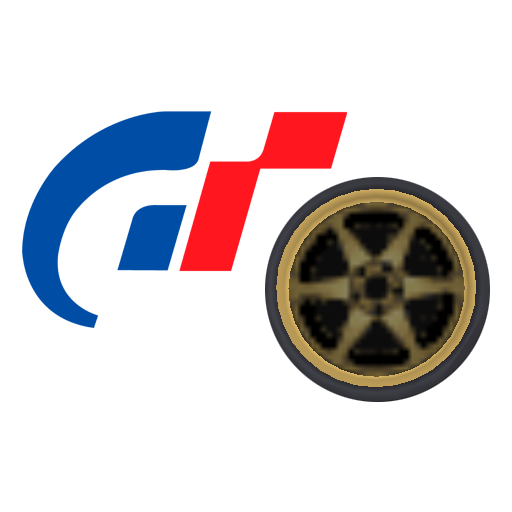

# GT3 Wheel Editor



  [](LICENSE)
  [](https://www.python.org/)
  
  []()
  [](https://github.com/JeevesGB/GTExplorer/commits/main)

A colour / palette editor for Gran Turismo 3 wheel files (GTTW), inspired by pPainter.

- Load standalone `wheel/` files or the wheel section from car models
- Edit the rim texture palette (CLUT)
- Live OpenGL 3D preview of the wheel
- Save the modified GTTW

## Requirements

- Python 3.10+
- PyQt6, PyOpenGL, numpy, Pillow

```bash
pip install -r requirements.txt
```

## Running

```bash
python main.py
```
